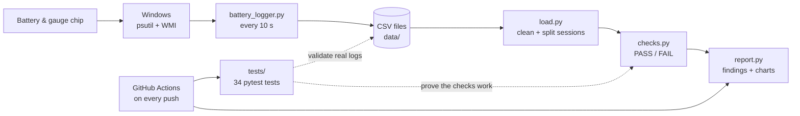
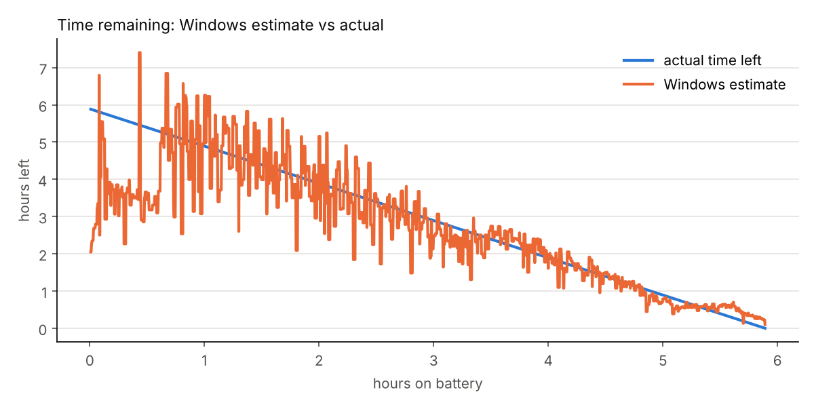
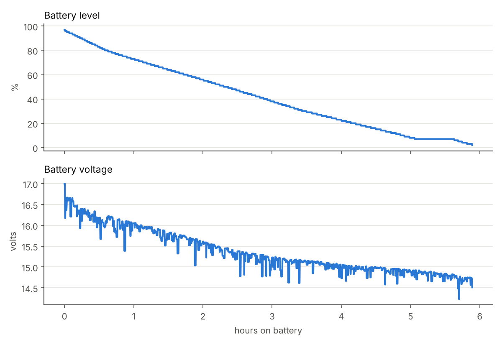
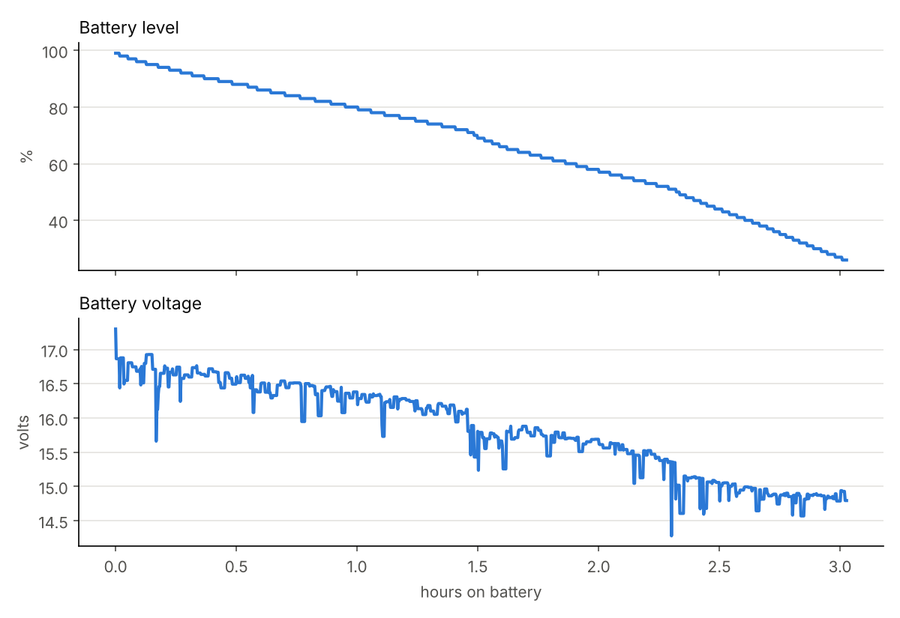
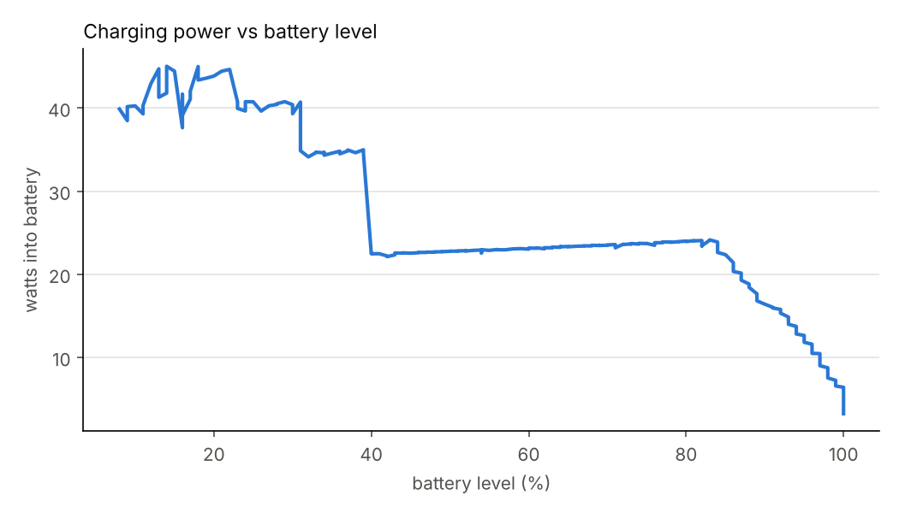

# Battery Telemetry Logger & Test Framework

I wanted to understand how a laptop's battery gauge actually behaves: how it decides the battery %, how good its "time remaining" guess is, how it charges, and what happens near empty. So I built a small toolkit to log real battery data from two Windows laptops, run automated checks on it, and turn the results into charts.

| Part | What it does |
|---|---|
| `battery_logger.py` | Logs battery %, Windows' time-left estimate, voltage, remaining / full-charge capacity, charge and discharge power, and CPU load every 10 s to a CSV |
| `battery_analysis/` | Cleans the logs, splits them into charge / discharge / sleep sessions, runs checks on each session, and makes charts |
| `tests/` | 34 pytest tests: unit tests for every check (on small fake logs where the right answer is known) plus validation tests that run on every real log in `data/` |

GitHub Actions runs the tests and generates the reports on every push.

**Visual walkthrough:** [`docs/index.html`](docs/index.html) is an interactive explainer of the whole project, with a replay of a real night on battery, animated diagrams, and charts. To view it online, turn on GitHub Pages (Settings → Pages → Deploy from branch → `main` / `docs`).



## How to use it

```bash
pip install -r requirements.txt

# 1. Log (Windows). Unplug the laptop, then:
python battery_logger.py --label personal-idle

# 2. Analyze: prints PASS/FAIL checks and saves charts to reports/
python -m battery_analysis.report data/personal-idle_2026-10-11.csv --design-mwh 57050

# 3. Test
pytest -v
```

The design capacity isn't always available from the battery driver; get it from `powercfg /batteryreport`.

## Checks

| Check | Why it matters |
|---|---|
| % never rises on battery | A rising % while unplugged means the gauge is confused |
| % drops at most 2 points per sample | Big jumps feel broken to users |
| % matches remaining / full-charge capacity | The number on screen should match what the battery reports |
| Charge reading never frozen > 10 min | A stuck reading hides real drain from the user and the OS |
| Time-left estimate within 25% of actual | Users plan around this number (only judged on runs that ran to near empty) |
| Capacity vs design capacity | How worn the battery is, and whether the gauge recalibrated |
| CPU load vs power draw | How much workload drives drain |
| Charging profile | Charging power at 20 / 50 / 80 / 90 / 95%, time to 100%, and charging after 100% is shown |

## The two laptops

| | Personal laptop | Work laptop (refurbished) |
|---|---|---|
| Pack voltage | ~17 V (4 cells) | ~12.3 V (3 cells) |
| Design → full-charge capacity | 57,050 → 38,900 mWh | 50,012 → 37,734 mWh |
| Health | **68%** | **75%** |
| Cycle count | 528 | 38 (battery made in 2019) |
| Likely cause of wear | Heavy use (cycle aging) | Age (calendar aging) |

Both batteries have lost a quarter to a third of their capacity, for different reasons. The personal laptop's report shows its capacity falling from about 59 Wh in March 2023 through 528 cycles; the work laptop's battery has barely been cycled but is seven years old.

## Findings

### 1. The time-left estimate swings a lot

Overnight idle run (personal, 97% → 2% in 5.9 h at about 5.4 W):

| Battery % | Windows said | Actually lasted | Error |
|---|---|---|---|
| 90% | 215 min | 340 min | −37% |
| 75% | 372 min | 303 min | +23% |
| 50% | 111 min | 215 min | −49% |
| 25% | 152 min | 126 min | +20% |
| 10% | 27 min | 62 min | −57% |

The estimate is based on the last few minutes of power draw, so short spikes and quiet periods throw it off.



### 2. The gauge froze at 7% for 31 minutes

Remaining capacity stayed at exactly 2,710 mWh while the laptop kept drawing about 4.7 W, roughly 2.4 Wh (about 6% of the battery) that the gauge didn't show. Then it recalibrated: full-charge capacity dropped from 40,690 to 38,900 mWh (−4.4%) and the % started moving again. My guess is the gauge holds its estimate until it reaches a known low-voltage point, then corrects itself. I'd like to learn how real gauges handle this.



### 3. Workload changes drain rate and voltage

Load run (personal, 99% → 26% in 3 h):

| Phase | Median power | Drain rate | Median voltage |
|---|---|---|---|
| Light use | 6.5 W | 18 %/h | 16.4 V |
| Virtual machine running | 8.4 W | 25 %/h | 15.7 V |
| VM + HD video | 12.1 W | 36 %/h | 14.9 V |

Both the drain slope and the voltage step down when each workload starts. Short dips in voltage line up with load spikes (voltage sag), the deepest to 14.3 V.



### 4. Low-battery behavior

At 2% Windows hibernated the laptop. Over the next 3.5 hours it lost only about 400 mWh (~116 mW). On wake it pulled 23.7 W at 75% CPU while still at 2%, and stayed up.

### 5. Two very different charging styles

The personal laptop charged 8% → 100% in 98 minutes in clear stages: about 40–45 W up to 30%, about 35 W to 40%, about 23 W to 83%, then slowing steadily to about 5 W at the top. It showed 100% and kept charging for 26 more minutes.

The work laptop charged 79% → 100% in 19 minutes at a steady ~26 W with no slowdown before stopping. I'd want to investigate why.



### 6. The work laptop's "overnight drain" wasn't a sleep problem

The work laptop was found at 0% after being put to sleep. A controlled test (2.5 h asleep) lost only 4%, so sleep itself was fine. Windows' power-state history showed the real cause: on two evenings the laptop was woken by accident while being packed up (touchpad input once, the power button once), and because auto-sleep was set to "Never," it ran for about 6 hours until Windows forced sleep at 5%. Fix: sleep after 10–15 minutes on battery, lid close = sleep, critical action = hibernate.

### 7. Bugs found in my own tools

- **Logger:** when Windows has no estimate it reports time-left as 4294967295 (0xFFFFFFFF), not blank. Found in the first real run; fixed, with a test.
- **Analysis:** the estimate check first assumed every run ends at empty. On the load run (stopped at 26%) that produced a meaningless 189% "error." The check now skips runs that didn't reach near empty, with a test for it.

## Next

- Temperature logging (cold batteries deliver less)
- Scripted, repeatable load profiles instead of manual ones
- Compare against public lab data (NASA battery dataset)
